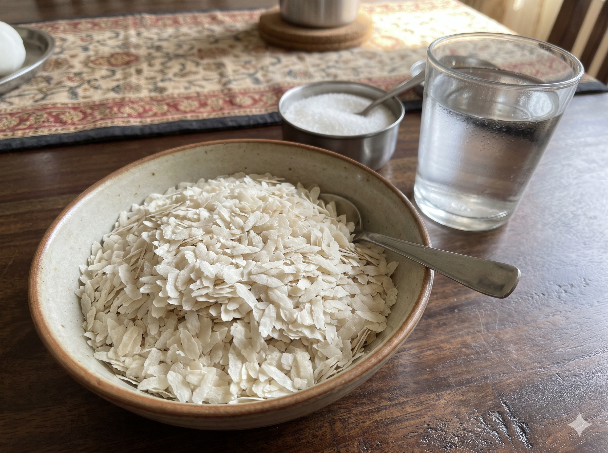
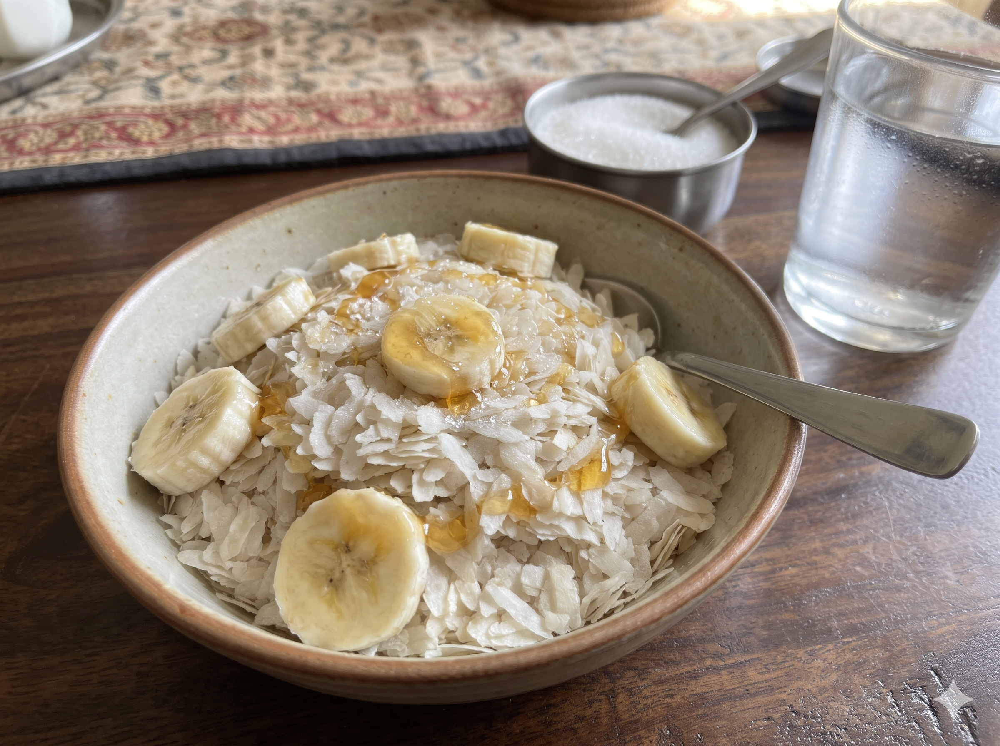

# 🍲 Recipe Whisperer

**Recipe Whisperer** transforms vague, traditional, and informal spoken recipe instructions into exact metric measurements (grams, milliliters, minutes) and auto-generates visual step-by-step cooking slides with synthesized audio readback.

Built for **The Great Indian AI Internship Challenge** by **Gnani AI**.

---

## 📹 Video Demo

https://github.com/senjumamonster/recipe_whisperer/assets/demo.mp4

---

## 🖼️ Step-by-Step Cooking Slides

| Step 1: Prep & Soak | Step 2: Mix & Sweeten | Step 3: Garnish & Serve |
| :---: | :---: | :---: |
|  |  |  |
| *Soak paper aval in water & drain* | *Add sugar, sliced bananas & honey* | *Top with fresh grated coconut* |

---

## 🛠️ Tech Stack & Architecture

- **Speech-to-Text:** [Gnani Prisma STT (v3.0)](https://www.gnani.ai/) — Captures informal multi-lingual spoken voice input.
- **Recipe Intelligence:** Google Gemini 3.8 Flash — Normalizes informal units into exact metric quantities and structures step-by-step instructions.
- **Text-to-Speech:** [Gnani Timbre TTS (v2.5)](https://www.gnani.ai/) — Synthesizes natural audio readback for visual step slides.
- **Frontend Framework:** Streamlit
- **Image Handling:** PIL (Pillow) & Dynamic Glob Fallbacks

---

## 🚀 Key Features

1. **Voice-First Input:** Speak naturally in Hinglish, English, Kannada, or Tamil.
2. **Metric Standardization:** Automatically converts terms like *"a handful of poha"* or *"cook till it smells right"* into precise grams and exact cooking times.
3. **Visual Step Slides:** Auto-maps normalized steps directly to visual cooking cards.
4. **Audio Narration:** Provides hands-free voice readback for kitchen convenience.

---

## 🏃 Local Setup Instructions

1. **Clone the repository:**
   ```bash
   git clone [https://github.com/senjumamonster/recipe_whisperer.git](https://github.com/senjumamonster/recipe_whisperer.git)
   cd recipe_whisperer

   Install dependencies:

Bash
pip install streamlit google-genai requests pillow
Set Environment Variables:

Bash
export GNANI_API_KEY="your_gnani_api_key"
export GEMINI_API_KEY="your_gemini_api_key"
Run the Streamlit application:

Bash
streamlit run app.py

---

### How to update it on GitHub:
1. Go to `[https://github.com/senjumamonster/recipe_whisperer/blob/main/README.md](https://github.com/senjumamonster/recipe_whisperer/blob/main/README.md)`.
2. Click the **Pencil (Edit)** icon at the top right of the file.
3. Replace the text with the block above and click **Commit changes**.

*(Note: The table uses `step1.png.png`, `step2.png.png`, and `step3.png` matching the exact upl
